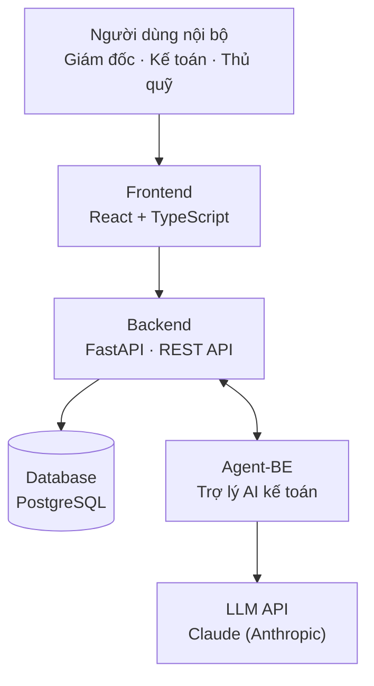
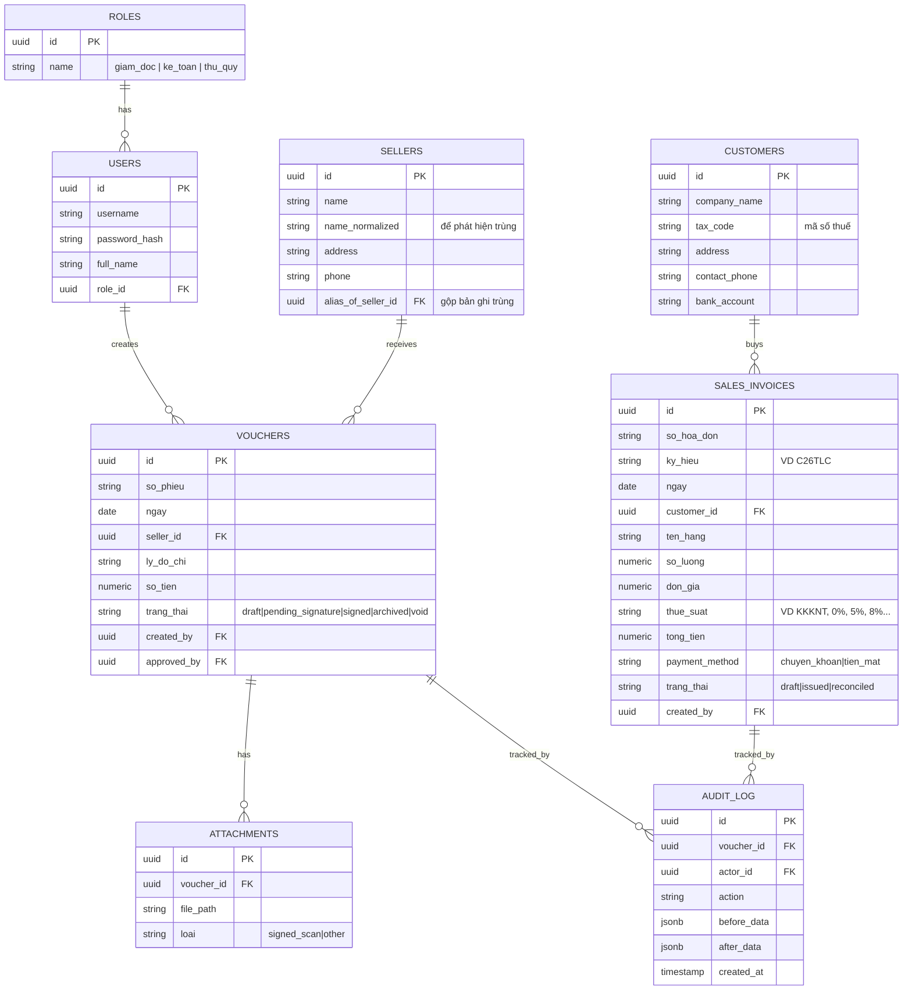
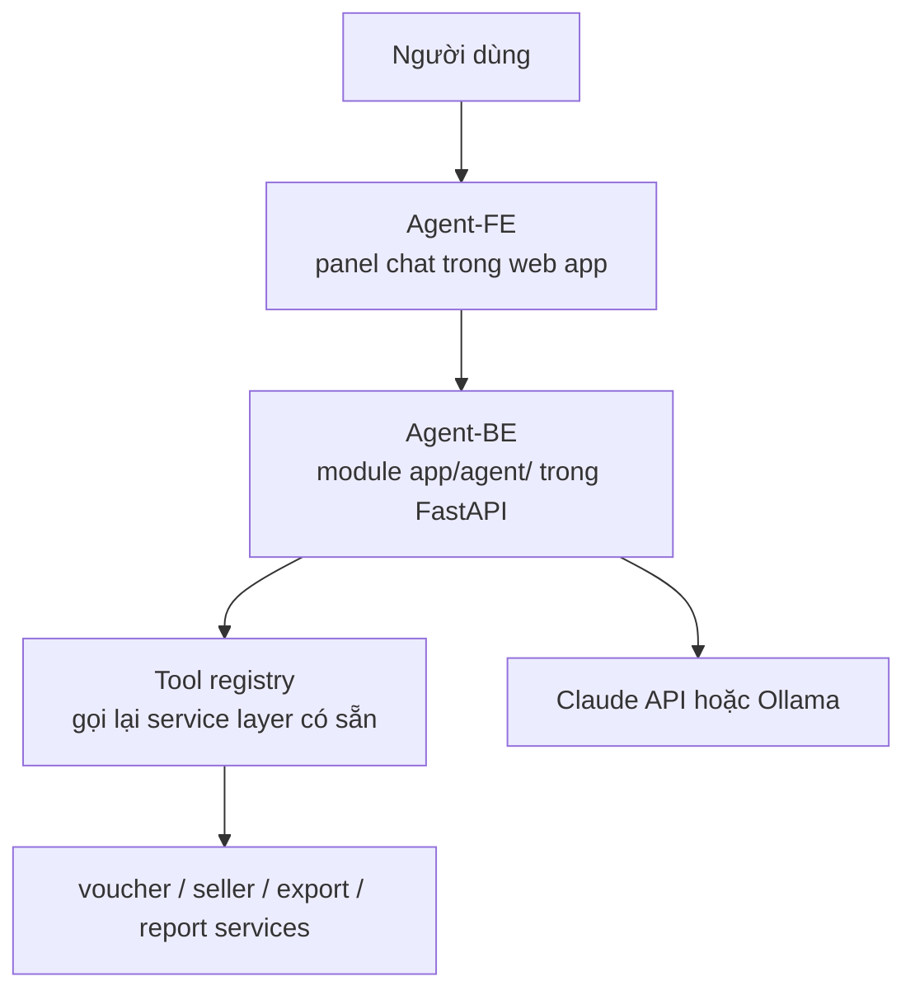
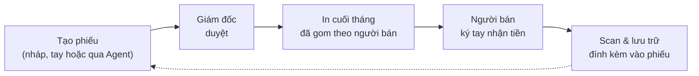

# Kế hoạch xây dựng hệ thống quản lý kế toán nội bộ

> Tài liệu này là bản kế hoạch làm việc — chỉnh sửa/thêm bớt tự do khi triển khai thực tế. Các trích dẫn quy định pháp luật trong tài liệu mang tính tham khảo, không thay thế tư vấn của kế toán/luật sư của bạn.

---

## 0. Tóm tắt & giả định

- **Xuất phát điểm**: dữ liệu phiếu chi hiện quản lý qua Excel (2 sheet CHI/LUU), mỗi phiếu 1 block 21 dòng, kế toán tạo/in thủ công cuối tháng.
- **Mục tiêu**: giảm phụ thuộc vào một kế toán duy nhất, giảm sai sót/thời gian thao tác thủ công, có audit trail, backup, phân quyền — **không phải** loại bỏ hoàn toàn con người khỏi quy trình kế toán, và **không** cố xoá bỏ bước ký tay của người bán (lý do pháp lý, xem phần 3.2).
- **Giả định khi lập kế hoạch** (điều chỉnh nếu sai): bạn là người trực tiếp code (một mình hoặc với hỗ trợ nhỏ), tái sử dụng stack đã quen (FastAPI + React/TypeScript + SQL), quy mô công ty gia đình (vài chục người bán, vài trăm phiếu/tháng), có thể triển khai dần theo giai đoạn thay vì làm một lần.

---

## 1. Bối cảnh hiện tại

- Công ty (ví dụ: **CÔNG TY TNHH NÔNG SẢN MẪU — Công ty ABC**) mua nông sản (chủ yếu mủ cao su) trực tiếp từ các cá nhân bán hàng, thanh toán bằng "Phiếu chi" (Mẫu 02-TT), kèm "Bảng kê 02/TNDN" hợp thức hoá chi phí không hoá đơn.
- Kế toán lập phiếu trên Excel, cuối tháng in hàng loạt, mang cho từng người bán ký nhận tiền.
- **Có cả chiều bán ra**: công ty gom mủ từ nhiều người bán rồi bán lại cho khách hàng doanh nghiệp — ví dụ **CÔNG TY TNHH ĐỐI TÁC A** — có xuất hoá đơn GTGT, thanh toán qua chuyển khoản (khác với chiều mua, trả tiền mặt cho cá nhân). Công ty dự kiến sẽ có thêm khách hàng khác trong tương lai.
- Đã xử lý xong việc chuẩn hoá & gom nhóm dữ liệu 4 tháng gần nhất (T3–T6) theo người bán, kèm 1 script Python (`gom_nhom_phieu_chi.py`) tái sử dụng được. Script này chính là hạt nhân của module "xuất file in hàng loạt" trong hệ thống mới (xem phần 6.3).

---

## 2. Mục tiêu & phi mục tiêu

**Mục tiêu:**
1. Một nơi duy nhất lưu toàn bộ phiếu chi, có lịch sử thay đổi (audit trail).
2. Giảm thao tác thủ công: tạo phiếu nhanh hơn, tự động gom nhóm/in cuối tháng, tự phát hiện trùng tên người bán.
3. Phân quyền rõ ràng (giám đốc / kế toán / thủ quỹ), không phụ thuộc 1 người duy nhất nắm hết dữ liệu.
4. Backup tự động, đáp ứng thời hạn lưu trữ chứng từ theo quy định.
5. Trợ lý AI (Agent-BE) hỗ trợ nhập liệu nhanh và trả lời truy vấn ("tháng này đã chi bao nhiêu cho anh A?").
6. Quản lý **khách hàng** (bên mua lại hàng hoá từ công ty, VD Công ty Đối tác A) tách biệt với **người bán** (nông dân bán mủ cho công ty) — có thể mở rộng thêm nhiều khách hàng khi công ty phát triển.

**Phi mục tiêu (không làm, ít nhất ở giai đoạn đầu):**
- Không thay thế vai trò kế toán trong việc quyết toán thuế, lập báo cáo tài chính.
- Không cố số hoá chữ ký của người bán cá nhân bằng chữ ký điện tử (đa số họ không có chữ ký số hợp lệ).
- Không để Agent-BE tự động duyệt/phát hành phiếu chi mà không có người xác nhận.

---

## 3. Đánh giá rủi ro

### 3.1 Rủi ro quy trình hiện tại (thủ công qua Excel)

| Rủi ro | Mô tả | Mức độ |
|---|---|---|
| Phụ thuộc 1 người | Kế toán nghỉ/ốm/nghỉ việc → không ai tạo được phiếu | Cao |
| Sai sót nhập liệu | Thực tế phát hiện 235/284 phiếu (83%) tháng 6 từng thiếu tên người bán | Cao |
| Không có audit trail | Không biết ai sửa gì, lúc nào | Trung bình–cao |
| Mất dữ liệu | File nằm trên 1 laptop, không backup | Cao |
| Trùng lặp master data | Tên người bán viết không nhất quán → khó tổng hợp đúng | Trung bình |
| Đánh số phiếu thủ công | Dễ trùng/nhảy số, có thể bị hỏi khi quyết toán/thanh tra thuế | Trung bình |
| Hiệu suất | In/gom hàng trăm phiếu thủ công cuối tháng tốn thời gian | Trung bình |

### 3.2 Rủi ro pháp lý / tuân thủ cần lưu ý khi số hoá

*(Tham khảo, không thay thế tư vấn chuyên môn — nên nhờ kế toán/luật sư xác nhận trước khi vận hành chính thức.)*

- **Bảng kê mua hàng không hoá đơn**: phần lớn giao dịch của công ty là mua nông sản trực tiếp từ cá nhân sản xuất, thuộc diện phải lập Bảng kê thu mua hàng hoá không có hoá đơn (hiện là mẫu 01/TNDN theo Thông tư 78/2014/TT-BTC, dự kiến đổi thành mẫu 02/TNDN theo Thông tư 20/2026/TT-BTC) thì chi phí mới được trừ khi tính thuế TNDN. Hệ thống nên có báo cáo xuất đúng mẫu này theo kỳ.
- **Thời hạn lưu trữ chứng từ**: phiếu chi không dùng trực tiếp ghi sổ kế toán → lưu tối thiểu 5 năm; nếu dùng trực tiếp ghi sổ/lập báo cáo tài chính → tối thiểu 10 năm (Luật Kế toán 2015, Nghị định 174/2016/NĐ-CP). Thiết kế backup/retention theo mốc này.
- **Bảo vệ dữ liệu cá nhân**: từ 1/1/2026, Luật Bảo vệ Dữ liệu Cá nhân (số 91/2025/QH15) có hiệu lực, thay Nghị định 13/2023/NĐ-CP. Hệ thống lưu tên/SĐT/địa chỉ/CCCD của người bán cá nhân cần tuân thủ (mục đích sử dụng rõ ràng, bảo mật, quyền của chủ thể dữ liệu).
- **Giá trị pháp lý chữ ký**: người bán phần lớn là cá nhân không có chữ ký số hợp lệ → không nên cố thay chữ ký tay bằng chữ ký điện tử cho nhóm này. Hệ thống chỉ số hoá phần chuẩn bị (trước ký) và lưu trữ (sau ký, dạng ảnh scan đính kèm).
- **Hoá đơn điện tử (chiều bán ra)**: từ 1/7/2026, hoá đơn điện tử chịu sự điều chỉnh của Nghị định 254/2026/NĐ-CP (hướng dẫn Luật Quản lý thuế 2025), thay cho các quy định trước đó. Hệ thống **không nên tự phát hành hoá đơn GTGT hợp lệ về mặt pháp lý** (việc này cần kết nối với cơ quan thuế qua nhà cung cấp hoá đơn điện tử được cấp phép) — module bán hàng nên dừng ở mức lưu trữ/theo dõi nội bộ, và tích hợp (hoặc xuất dữ liệu sang) phần mềm hoá đơn điện tử mà kế toán đang dùng, thay vì tự làm hệ thống phát hành hoá đơn.

### 3.3 Rủi ro khi triển khai hệ thống mới

| Rủi ro | Giảm thiểu |
|---|---|
| Bạn là điểm phụ thuộc kỹ thuật duy nhất | Tài liệu hoá code kỹ, README rõ ràng, cân nhắc nhờ người thứ 2 hiểu hệ thống |
| Agent AI làm sai/quá tay | Nguyên tắc cứng: agent chỉ tạo **nháp**, không tự duyệt/phát hành |
| Bảo trì dài hạn (hosting, bảo mật, vá lỗi) | Tính chi phí/thời gian vận hành, không chỉ chi phí xây dựng ban đầu |
| Di trú dữ liệu từ Excel bị sai/thiếu | Đối chiếu tổng số tiền & số lượng phiếu trước/sau khi import (như đã làm ở bước gom nhóm) |
| Cắt hẳn quy trình cũ quá sớm | Chạy song song hệ thống mới + Excel cũ tối thiểu 1–2 tháng trước khi cutover |

---

## 4. Kiến trúc tổng thể



Nguyên tắc quan trọng: **Agent-BE không truy cập Database trực tiếp** — mọi thao tác đọc/ghi của agent đều đi qua Backend, dùng đúng lớp validate/nghiệp vụ/audit-log như khi người dùng thao tác qua Frontend. Điều này đảm bảo agent không thể "lách" qua các ràng buộc nghiệp vụ (VD: không thể tự tạo phiếu vượt qua bước xác nhận).

**Đề xuất công nghệ:**

| Thành phần | Đề xuất | Vì sao |
|---|---|---|
| Frontend | React 19 + TypeScript + Ant Design hoặc shadcn/ui | Bạn đã quen React 19 + TS từ dự án trước; Ant Design có sẵn component bảng/form phù hợp phong cách app nghiệp vụ tiếng Việt |
| Backend | Python + FastAPI + SQLAlchemy + Pydantic | Bạn đã có kinh nghiệm FastAPI; dễ chia sẻ logic/model với Agent-BE cùng ngôn ngữ |
| Database | PostgreSQL (khuyến nghị) hoặc SQLite | Xem phần 5.1 |
| Agent-BE | Python, kiến trúc tool-calling giống hệ agent bạn từng xây (registry tool + RAG + memory) | Tái sử dụng pattern đã kiểm chứng, chỉ đổi domain sang kế toán |
| Auth | JWT + RBAC (role-based access control) | Đơn giản, đủ dùng cho quy mô nội bộ |
| Backup | pg_dump định kỳ + lưu off-site (cloud storage khác máy chủ chính) | Đáp ứng yêu cầu lưu trữ nhiều năm mà không phụ thuộc 1 máy |

---

## 5. Thiết kế Database

### 5.1 SQLite hay PostgreSQL?

| | SQLite | PostgreSQL |
|---|---|---|
| Ưu điểm | Đơn giản, bạn đã quen (dự án lượng tử trước dùng SQLite) | Chịu được nhiều người dùng ghi đồng thời, công cụ backup/replication chuẩn, phù hợp dữ liệu "thật" có tiền |
| Nhược điểm | Khoá ghi (write lock) khi nhiều người dùng cùng lúc; backup phải tự làm cẩn thận (VD: Litestream) | Cần cài đặt/vận hành thêm một chút |
| Khuyến nghị | Chỉ nên dùng nếu chắc chắn luôn có ≤1 người ghi cùng lúc | **Khuyến nghị dùng cho hệ thống này** — vì đây là dữ liệu tiền thật, nhiều vai trò (giám đốc/kế toán/thủ quỹ) có thể thao tác cùng lúc |

### 5.2 Schema chính (rút gọn)



Bảng phụ khác: `accounts` (tài khoản Nợ/Có theo chế độ kế toán đang áp dụng), `sequence_counters` (cấp số phiếu tự động theo tháng/năm, tránh trùng), `bang_ke_tndn_exports` (log các lần xuất Bảng kê 01/TNDN).

**Vì sao tách `sellers` và `customers` thành 2 bảng riêng** (thay vì gộp chung 1 bảng "đối tác"): hai bên có hình dạng dữ liệu khác hẳn nhau — người bán là cá nhân (CCCD, không mã số thuế) trả tiền mặt có chữ ký tay; khách hàng là doanh nghiệp (mã số thuế, tài khoản ngân hàng) thanh toán chuyển khoản, cần hoá đơn GTGT. Tách riêng giúp form nhập liệu và validate đơn giản hơn, đúng với cách 2 loại chứng từ (Bảng kê 02/TNDN vs Hoá đơn GTGT) vốn đã khác nhau trong thực tế.

**Ghi chú quan trọng**: `audit_log` nên là bảng **append-only** (chỉ thêm, không sửa/xoá) — đúng pattern event-sourcing bạn đã làm ở `story_timeline_service` (EventStore + immutability trigger). Đây là cách chuẩn để đảm bảo không ai (kể cả admin) sửa lại lịch sử sau khi đã ghi nhận.

---

## 6. Thiết kế Backend

### 6.1 Module chính

- **auth**: đăng nhập, JWT, phân quyền theo role.
- **sellers**: CRUD người bán; khi tạo mới, chạy fuzzy-match (VD thư viện `rapidfuzz`) so với danh sách hiện có để cảnh báo trùng trước khi lưu.
- **vouchers**: CRUD phiếu chi, quản lý state machine (`draft → pending_signature → signed → archived`, hoặc `→ void`), cấp số phiếu tự động (không cho sửa tay để tránh trùng/nhảy số).
- **attachments**: upload ảnh/scan phiếu đã ký, gắn vào voucher tương ứng, tự chuyển trạng thái sang `signed`.
- **export**: tái sử dụng trực tiếp logic từ `gom_nhom_phieu_chi.py` — nhận input là 1 kỳ (tháng), trả về file Excel/PDF đã gom nhóm theo người bán, sẵn sàng in. Thêm 1 hàm xuất Bảng kê 01/TNDN cùng kỳ.
- **audit**: middleware tự động ghi `audit_log` cho mọi hành động tạo/sửa/duyệt/xuất file — không để module nghiệp vụ tự ghi log (tránh quên).
- **reports**: tổng chi theo người bán/tháng, dữ liệu cho dashboard.
- **customers**: CRUD khách hàng (bên mua lại hàng, VD Công ty Đối tác A) — đơn giản hơn `sellers` vì hiện tại số lượng ít.
- **sales**: ghi nhận hoá đơn bán ra (`sales_invoices`) — chỉ lưu/theo dõi nội bộ, **không tự phát hành hoá đơn pháp lý** (xem lưu ý tuân thủ ở 3.2). Nếu kế toán đang dùng phần mềm hoá đơn điện tử riêng, module này nên có chỗ nhập lại số/ký hiệu hoá đơn đã phát hành từ phần mềm đó để đối chiếu, thay vì sinh số hoá đơn riêng.

### 6.2 Nguyên tắc thiết kế quan trọng

- Số phiếu (`so_phieu`) **luôn** do hệ thống cấp, không cho nhập tay — tránh trùng/nhảy số (rủi ro đã nêu ở 3.1).
- Mọi thay đổi dữ liệu phiếu **sau khi đã in để ký** đều bị khoá (immutable) — muốn sửa phải tạo phiếu điều chỉnh mới, không sửa đè lên phiếu cũ (giữ đúng tinh thần chứng từ kế toán không được sửa sau khi phát hành).
- API cho Agent-BE gọi (phần 8) dùng **chung một bộ endpoint** với Frontend, không có "cửa sau" riêng — đảm bảo agent chịu mọi ràng buộc như người dùng thật.

### 6.3 Module xuất file — kế thừa trực tiếp từ script đã có

`gom_nhom_phieu_chi.py` (đã viết và kiểm chứng) trở thành một service function trong Backend, ví dụ:

```python
def export_grouped_by_seller(db_session, month: int, year: int) -> bytes:
    vouchers = query_vouchers(db_session, month, year)
    # áp lại đúng logic: gom nhóm theo seller_id, sort alphabet,
    # sinh file Excel với separator + page break — như đã làm
    ...
    return excel_bytes
```

Không cần viết lại từ đầu — chỉ đổi nguồn dữ liệu từ đọc file Excel sang query Database.

---

## 7. Thiết kế Frontend

Màn hình chính:

1. **Đăng nhập**
2. **Dashboard**: tổng chi tháng này, top người bán, số phiếu chờ duyệt/chờ ký
3. **Danh sách phiếu chi**: lọc theo người bán / tháng / trạng thái
4. **Tạo & sửa phiếu chi**: form với ô người bán dùng autocomplete (chọn từ master data, không gõ tự do — để tránh lặp lỗi trùng tên đã gặp), có thể bật "nhập nhanh bằng AI" gọi Agent-BE
5. **Duyệt phiếu**: hàng đợi cho giám đốc xác nhận trước khi in
6. **Quản lý người bán**: CRUD, cảnh báo/gộp bản ghi trùng
7. **In hàng loạt cuối tháng**: chọn kỳ → xem trước → xuất file gom nhóm (chính là tính năng đã làm, nay chạy trực tiếp trên web)
8. **Xuất Bảng kê 01/TNDN**: chọn kỳ → xuất đúng mẫu
9. **Upload phiếu đã ký**: chụp/scan → gắn vào đúng phiếu, chuyển trạng thái
10. **Báo cáo**: biểu đồ chi theo tháng/người bán
11. **Quản lý khách hàng**: CRUD khách hàng (bên mua), tách riêng khỏi màn "Quản lý người bán"
12. **Hoá đơn bán ra**: danh sách + tạo mới (ghi nhận nội bộ, đối chiếu với hoá đơn điện tử đã phát hành thật)

---

## 8. Thiết kế Agent-BE và Agent-FE

### 8.0 Đã có sẵn — không phải làm từ đầu

Tính năng scan bảng kê (đã xây, đã test) thực chất CHÍNH LÀ tool đầu tiên của Agent-BE, chỉ là lúc đó chưa gọi tên vậy:
- `app/services/scan_extraction_service.py` — đã có 2 provider (Claude API / Ollama local), pattern chuẩn "model đề xuất → 2 lớp kiểm tra chéo → người xem/sửa → xác nhận → tạo nháp".
- `audit_log.actor_type` đã có sẵn giá trị `"agent"` để phân biệt hành động AI với hành động người thật — không cần sửa schema.
- `ScanImportPage.tsx` (Frontend) đã là 1 ví dụ THẬT của "thẻ đề xuất có thể sửa tay" — dùng làm khuôn mẫu UI cho mọi tool ghi dữ liệu khác, không thiết kế lại từ đầu.

### 8.1 Kiến trúc tổng thể



**Agent-BE nằm TRONG backend hiện có** (thư mục mới `app/agent/`), không tách service riêng — dùng chung DB session, chung auth JWT, chung service layer đã kiểm chứng (numbering_service, fuzzy_match_service, export_service...). Đúng nguyên tắc "code 1 mình, giữ monolith" đã thống nhất từ đầu, và tránh việc phải đồng bộ business logic ở 2 nơi.

### 8.2 Ranh giới cứng: READ (tự chạy) vs WRITE (luôn phải xác nhận)

| Loại | Nghĩa | Agent được phép |
|---|---|---|
| **READ** | Chỉ đọc, không đổi gì trong DB | Tự chạy, trả kết quả ngay trong chat |
| **WRITE** | Tạo/sửa dữ liệu kế toán | **Chỉ được đề xuất** — trả về 1 "thẻ hành động" chờ người bấm Xác nhận, không tự thực thi |

Ranh giới này áp cho mọi tool tương lai, không riêng gì scan — đúng "rào chắn bắt buộc" đã chốt từ phiên kế hoạch đầu tiên.

### 8.3 Danh sách tool

| Tool | Loại | Trạng thái |
|---|---|---|
| `extract_scan_bang_ke` | WRITE (đề xuất) | ✅ Đã xây, đã test |
| `create_voucher_draft` | WRITE (đề xuất) | Chưa — parse câu tự nhiên ("mua 500kg mủ anh Kiếm giá 15.000") thành form tạo phiếu, tái dùng schema `ExtractedRow` đã có |
| `search_seller` | READ | Service có sẵn (`fuzzy_match_service.py`), chưa nối vào agent |
| `get_monthly_summary` (hỏi đáp số liệu) | READ | Chưa — dùng query có kiểm soát trên `reports.py`, **không cho LLM tự viết SQL** (rủi ro injection/đọc nhầm bảng) |
| `generate_grouped_print_file` | READ (export) | Service có sẵn (`export_service.py`), chưa nối agent |
| `generate_bang_ke_tndn` | READ (export) | Service có sẵn, chưa nối agent |
| `flag_anomaly` | READ | 1 phần đã có (kiểm tra phép nhân trong scan) — mở rộng: so giá với lịch sử của đúng người bán đó |

### 8.4 Agent-FE — giao diện chat

- 1 panel chat trượt ra từ nút nổi, dùng được ở **mọi trang** (không phải trang riêng biệt) — để gõ được ngay lúc đang xem phiếu/người bán, không phải chuyển tab.
- Hành động WRITE → hiện dưới dạng **thẻ đề xuất có thể sửa tay** + 2 nút Xác nhận/Huỷ — tái dùng đúng pattern bảng-có-thể-sửa-kèm-cảnh-báo màu đã làm ở `ScanImportPage.tsx`, không dựng lại từ đầu.
- Câu hỏi READ → trả lời thẳng bằng text/bảng trong chat, không cần xác nhận.
- Agent-FE gọi đúng API hiện có (`/vouchers/`, `/scans/{id}/confirm`...) — **không có "cửa sau"**, đi qua đúng lớp kiểm soát/RBAC như thao tác tay (kế toán vẫn không duyệt được phiếu dù qua chat).

### 8.5 Lộ trình con (trong Phase 3)

| Bước | Nội dung |
|---|---|
| 3.1 | ✅ **Đã xong** — `app/agent/` (orchestrator + tool registry), 2 tool READ (`search_seller`, `get_monthly_summary`). Endpoint `POST /agent/chat`. 14 test mới (55/55 toàn bộ pytest PASS, kể cả 1 test gọi request thật tới Anthropic API để xác nhận đúng cấu trúc). |
| 3.2 | Agent-FE panel chat cơ bản — gõ câu hỏi, nhận trả lời text (chỉ tool READ) |
| 3.3 | Thêm tool WRITE đầu tiên qua chat: `create_voucher_draft`, dùng UI thẻ đề xuất |
| 3.4 | Nối `extract_scan_bang_ke` vào chat (thay vì chỉ có trang riêng `/scan-import`) |
| 3.5 | `flag_anomaly` mở rộng + tool export qua chat |

---

## 9. Vòng đời một phiếu chi



Bước D (ký tay) là bước **duy nhất** vẫn diễn ra ngoài hệ thống — vì lý do pháp lý đã nêu ở 3.2. Toàn bộ các bước còn lại được số hoá, và giờ có thể khởi tạo từ A qua Agent-BE (chat hoặc scan) thay vì chỉ nhập tay.

---

## 10. Lộ trình triển khai theo giai đoạn

| Giai đoạn | Nội dung | Ước lượng* |
|---|---|---|
| **0 — Chuẩn hoá dữ liệu** | Hoàn thiện master list người bán từ lịch sử Excel (đã có sẵn phần lớn từ việc gom nhóm T3–T6), rà trùng tên | 1 tuần |
| **1 — MVP** | DB schema, Backend CRUD phiếu chi + người bán + khách hàng + hoá đơn bán ra (đơn giản hơn, chưa cần workflow ký), Auth cơ bản, import dữ liệu lịch sử, module xuất file gom nhóm (port từ script đã có), Frontend tối giản | 3–4 tuần |
| **2 — Kiểm soát nội bộ** | Workflow duyệt phiếu, RBAC đầy đủ, audit log, upload ảnh phiếu đã ký | 2–3 tuần |
| **3 — Agent-BE** | Nhập liệu nhanh bằng ngôn ngữ tự nhiên, phát hiện trùng người bán, hỏi-đáp tự nhiên | 3–4 tuần |
| **4 — Nâng cao** | Xuất Bảng kê 01/TNDN tự động, dashboard báo cáo, backup tự động, rà bảo mật | 2 tuần |
| **5 — Chạy song song & cutover** | Chạy cùng lúc với Excel cũ 1–2 tháng, đối chiếu số liệu, rồi mới cắt hẳn | 4–8 tuần |

*Ước lượng cho hình dung tiến độ nếu làm part-time (xen kẽ việc học), không phải cam kết cứng — điều chỉnh theo thực tế.

---

## 11. Kiểm soát nội bộ cần giữ dù có hệ thống mới

- Tách biệt **người lập phiếu** và **người duyệt** nếu công ty đủ người; nếu chỉ 1–2 người trong gia đình đảm nhiệm hết, tối thiểu phải có log đầy đủ ai bấm nút gì, lúc nào.
- Đối chiếu định kỳ (VD: hàng tháng) giữa số liệu trong hệ thống và tiền mặt/số dư tài khoản thực tế.
- Backup tự động, lưu ở nơi khác với máy chủ chính.
- Agent AI chỉ đề xuất, không tự quyết hành động tài chính.
- Định kỳ (VD: mỗi năm) nhờ kế toán/thuế rà lại xem mẫu biểu, quy định (như mẫu 01/TNDN sắp đổi thành 02/TNDN) có gì thay đổi cần cập nhật vào hệ thống không.

---

## 12. Kế hoạch di trú dữ liệu từ Excel

1. Dùng lại đúng logic đọc block-phiếu đã viết trong `gom_nhom_phieu_chi.py` (phần dò `_detect_blocks`, `_get_name`, v.v.) để parse toàn bộ file Excel lịch sử (T3–T6, và các tháng cũ hơn nếu còn).
2. Danh sách người bán đã gom nhóm ở bước trước dùng làm master data ban đầu cho bảng `sellers` — rà thủ công một lần cho sạch (đã làm gần xong phần này).
3. Import từng phiếu vào bảng `vouchers`, giữ nguyên số phiếu gốc, đặt trạng thái `archived` (vì đã ký thực tế ngoài đời).
4. Đối chiếu tổng số phiếu & tổng số tiền trước/sau import — đúng cách đã làm khi kiểm tra file gom nhóm.

---

## 13. Đã chốt / còn cần làm rõ

**Đã chốt:**
- Triển khai: truy cập từ xa (cloud), quy mô ít người dùng cùng lúc → VPS nhỏ hoặc PaaS + Postgres managed.
- Bạn code một mình.
- Khách hàng = bên mua lại hàng hoá (VD Công ty Đối tác A), tách riêng khỏi người bán (nông dân).
- Đã xác nhận đúng Mẫu 02/TNDN (TT 20/2026/TT-BTC) và có thêm chiều bán ra (khách hàng, hoá đơn GTGT).

**Còn cần:**
- 1 ảnh phiếu chi đã ký thực tế (bạn sẽ cung cấp sau) — để chốt thiết kế màn "upload phiếu đã ký".
- Xác nhận với kế toán xem công ty có đang duy trì "sổ quỹ tiền mặt" riêng không — nếu có, hệ thống mới nên đối chiếu với sổ đó; nếu không, hệ thống sẽ đóng vai trò sổ quỹ từ đây trở đi.
- Kế toán đang dùng phần mềm hoá đơn điện tử nào (MISA, VNPT, Viettel...) — để module bán hàng tích hợp/đối chiếu đúng, thay vì tự phát hành hoá đơn (xem 3.2).
- Muốn bắt đầu code Giai đoạn 0/1 ngay (mình dựng schema DB + khung FastAPI) hay còn phần nào muốn bàn kỹ thêm trước?
